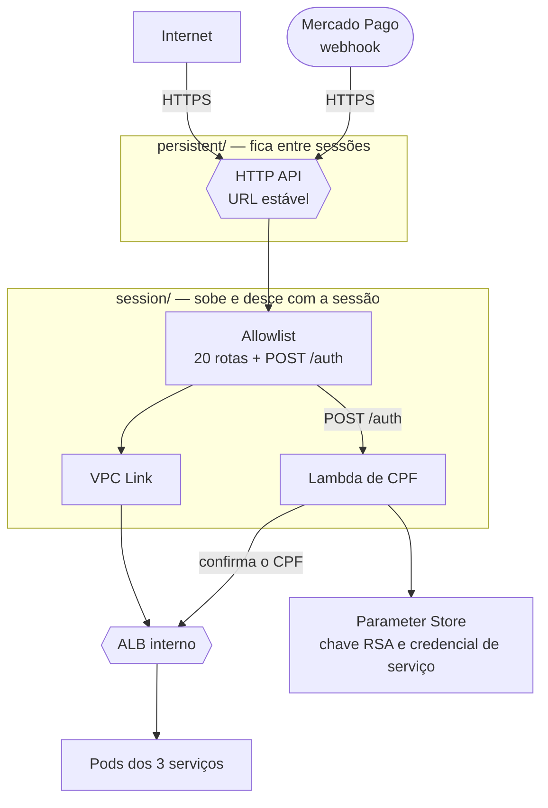

# fiap-fase4-auth-serverless

Borda da Fase 4 do Tech Challenge (FIAP SOAT): o **API Gateway** (HTTP API) que é a única entrada pública dos três
serviços, e a Lambda de autenticação por CPF. Terraform + Node.js.

> Evolução de [fiap-fase3-auth-serverless](https://github.com/CleytonOngaratto/fiap-fase3-auth-serverless).
> Arquitetura em
> [fiap-fase4-os-service/docs/arquitetura](https://github.com/CleytonOngaratto/fiap-fase4-os-service/tree/main/docs/arquitetura)
> — em especial o [ADR-003 (borda privada)](https://github.com/CleytonOngaratto/fiap-fase4-os-service/blob/main/docs/arquitetura/adr/ADR-003-borda-privada.md)
> e o [ADR-004 (Gateway persistente)](https://github.com/CleytonOngaratto/fiap-fase4-os-service/blob/main/docs/arquitetura/adr/ADR-004-gateway-persistente.md).



## Tecnologias

| Tecnologia | Versão | Uso |
|---|---|---|
| Terraform | **1.15.4** (`>= 1.11`) | os dois roots, `persistent/` e `session/` |
| Provider `hashicorp/aws` | **6.62.0** | fixado no `.terraform.lock.hcl` de cada root |
| Provider `hashicorp/archive` | **2.8.1** | empacota a função, no `session/` |
| Amazon API Gateway HTTP API e VPC Link | — | única entrada pública |
| AWS Lambda | runtime `nodejs20.x` | autenticação por CPF |
| Node.js | **20** | runtime e CI (`node --test`) |
| `@aws-sdk/client-ssm` | **3.1125.0** | lê a chave RSA e a credencial de serviço em runtime |
| `jsonwebtoken` | **9.0.3** | assina o JWT em RS256 |

As versões dos pacotes são as do [`lambda/package-lock.json`](lambda/package-lock.json).

## Dois roots de Terraform

| Root | O que cria | Ciclo de vida | Como aplica |
|---|---|---|---|
| [`persistent/`](persistent/) | HTTP API `fiap-fase4-api`, stage `$default` (*auto deploy*) e log group de acesso; publica `/fase4/apigw/api-id` e `/fase4/apigw/url` | **uma vez por conta do laboratório**; não entra no teardown de sessão; `prevent_destroy` no HTTP API | só `workflow_dispatch` (`root=persistent`) |
| [`session/`](session/) | VPC Link nas subnets privadas (o security group dele só sai para o ALB interno, na 80), uma integração com o listener do ALB e as rotas | sobe e desce com a sessão | `push` na `main` com mudança em `session/` ou em `lambda/`, ou `workflow_dispatch` (`root=session`) |

A URL do Gateway fica **estável entre sessões** porque o HTTP API mora no `persistent/`: é ela que vai para o painel
do Mercado Pago (webhook). States separados: `auth-serverless/persistent.tfstate` e `auth-serverless/session.tfstate`.

### Rotas publicadas (allowlist)

O casamento é **sensível a maiúsculas**, e nunca existe rota genérica (`/{proxy+}`) nem rota para `/q/*`: uma rota
genérica expõe health, métricas e OpenAPI. Tudo o que não está aqui recebe **404 do próprio Gateway**.

São as 20 rotas de [`session/locals.tf`](session/locals.tf) mais o `POST /auth` de [`session/routes.tf`](session/routes.tf):

| Serviço | Rotas |
|---|---|
| Autenticação do cliente | `POST /auth` |
| OS | `POST /carworkshop/v1/auth/login` · `ANY /carworkshop/v1/customers/{proxy+}` · `ANY /carworkshop/v1/vehicles/{proxy+}` · `ANY /carworkshop/v1/service` e `/service/{proxy+}` · `ANY /carworkshop/v1/parts-and-supplies` e `/parts-and-supplies/{proxy+}` · `ANY /carworkshop/v1/work-orders` e `/work-orders/{proxy+}` · `GET /carworkshop/v1/branches` · `GET /carworkshop/v1/tracking/{id}` |
| Billing | `GET /billing/v1/info` · `GET /billing/v1/budgets` · `GET /billing/v1/budgets/{id}` · `POST /billing/v1/budgets/{id}/approve` · `POST /billing/v1/budgets/{id}/reject` · `POST /billing/v1/webhooks/mercadopago` |
| Execution | `GET /execution/v1/info` · `GET /execution/v1/queue` · `ANY /execution/v1/work-orders/{proxy+}` |

`/carworkshop/v1/auth/signup` **não** é publicado: criar administrador é ação de atendimento, não de cliente.
`/carworkshop/v1/internal/*` também não: são rotas de serviço para serviço.

A Lambda de CPF (`lambda/`, testada no CI) vive no `session/`, e a rota `POST /auth` aponta para ela.

**A função não acessa banco nenhum.** Ela valida os dígitos do CPF, confirma o cliente num **endpoint interno
do OS Service** pelo ALB privado e assina o JWT. Suas únicas dependências são o Parameter Store (chave RSA e a
credencial de serviço, lidas em runtime por *nome*) e o ALB interno; o grupo de segurança dela só sai para 443,
para a porta 80 do ALB e para o DNS da VPC. OS Service indisponível resulta em **503**, distinto de erro
interno.

**A consulta é tentada duas vezes antes do 503.** Medido em sessão: a primeira chamada depois de os pods do OS
serem reagendados estourou o orçamento de 3 s, e a seguinte levou 17 ms — o custo é a primeira conexão ao ALB,
não a partida da função. Como a consulta é um `GET`, repeti-la é seguro, e isso troca um 503 no primeiro login
por mais 3 s no pior caso. **Credencial de serviço errada (401) e cliente ausente (404) não são retentados:**
são respostas, não falhas.

O porquê desse desenho e as duas camadas que protegem o endpoint estão no
[ADR-007](https://github.com/CleytonOngaratto/fiap-fase4-os-service/blob/main/docs/arquitetura/adr/ADR-007-lambda-sem-banco-do-os.md).

## Ordem

**Subida:** plataforma ([fiap-fase4-infra-k8s](https://github.com/CleytonOngaratto/fiap-fase4-infra-k8s)) →
`persistent/` (só na primeira vez da conta) → infra e deploy dos serviços → **`session/`**. O `session/` lê do SSM o
ID do HTTP API e o contrato da plataforma, e falha dizendo quem publica se faltar algo.

**Teardown:** o `session/` é o **primeiro** a sair (`scripts/destroy-all.ps1` da plataforma); o `persistent/`
**nunca** entra.

**O merge aplica.** Um merge que mude `session/`, `lambda/` ou o workflow aplica o `session/` — só com a sessão do
laboratório ligada, a plataforma e os serviços de pé, e o teardown na mesma sessão. `lambda/` está no filtro porque o
`archive_file` do `session/` zipa essa pasta: sem ela, um conserto na função seria mergeado e nunca chegaria a
produção. `tests/` fica fora de propósito — não entra no pacote da função.

## O que um *Reset* do laboratório apaga

Tudo o que foi criado na conta, inclusive o que é persistente: o HTTP API (a **URL muda**), o log group, os
parâmetros do SSM e o bucket de state. Depois de um Reset: recriar o bucket (`bootstrap-backend.ps1` da plataforma),
republicar o bootstrap do SSM, aplicar o `persistent/` de novo e **reconfigurar a URL do webhook no painel do Mercado
Pago**.

Apagar o HTTP API de propósito exige um PR que tire o `prevent_destroy` de
[`persistent/apigateway.tf`](persistent/apigateway.tf); um `destroy` do `persistent/` sem isso falha.

## Contrato no SSM

| Lê | De quem | Onde |
|---|---|---|
| `/fase4/apigw/api-id` | o `persistent/` deste repositório | `session/` |
| `/fase4/vpc/id`, `/fase4/vpc/cidr`, `/fase4/vpc/private-subnets`, `/fase4/alb/listener-arn`, `/fase4/alb/sg-id`, `/fase4/alb/dns` | plataforma ([fiap-fase4-infra-k8s](https://github.com/CleytonOngaratto/fiap-fase4-infra-k8s)) | `session/` |
| `/fase4/jwt/private-key` | bootstrap manual (sobrevive ao teardown) | a Lambda, em runtime, pelo nome |
| `/fase4/os/internal/service-token` | [fiap-fase4-os-service](https://github.com/CleytonOngaratto/fiap-fase4-os-service) | a Lambda, em runtime, pelo nome |
| `/fase4/apigw/url` | o `persistent/` deste repositório | smoke do `terraform.yml` |

| Publica | Conteúdo |
|---|---|
| `/fase4/apigw/api-id` | identificador do HTTP API, lido pelo `session/` |
| `/fase4/apigw/url` | URL pública do Gateway: é o `baseUrl` das collections do Postman e a base da URL do webhook no painel do Mercado Pago |

## Decisões (resumo)

Detalhamento na documentação arquitetural,
[`fiap-fase4-os-service/docs/arquitetura/`](https://github.com/CleytonOngaratto/fiap-fase4-os-service/tree/main/docs/arquitetura):
[ADR-003 — borda privada](https://github.com/CleytonOngaratto/fiap-fase4-os-service/blob/main/docs/arquitetura/adr/ADR-003-borda-privada.md),
[ADR-004 — Gateway persistente](https://github.com/CleytonOngaratto/fiap-fase4-os-service/blob/main/docs/arquitetura/adr/ADR-004-gateway-persistente.md) e
[ADR-007 — Lambda sem o banco do OS](https://github.com/CleytonOngaratto/fiap-fase4-os-service/blob/main/docs/arquitetura/adr/ADR-007-lambda-sem-banco-do-os.md).

| Decisão | Motivo |
|---|---|
| Dois roots de Terraform, `persistent/` e `session/` | a URL configurada no painel do Mercado Pago não pode mudar entre sessões |
| `prevent_destroy` no HTTP API | apagar o API muda a URL; exige um PR que tire a trava |
| Rotas em allowlist, por recurso | uma rota genérica expõe `/q/*`, e uma rota declarada sem integração não bloqueia nada (medido em 2026-10-01) |
| A Lambda não acessa banco | confirma o cliente num endpoint interno do OS, com credencial de serviço; nenhum serviço lê o banco de outro |
| Segredos lidos em runtime, pelo nome | um `data source` gravaria o valor decifrado no state, e uma variável de ambiente o mostraria no console |
| Uma retentativa do `GET` interno antes do 503 | a primeira chamada depois de os pods serem reagendados estourou 3 s, e a seguinte levou 17 ms |
| `lambda/**` no filtro de push do `terraform.yml` | o `archive_file` zipa a pasta: sem isso, um conserto na função seria mergeado e nunca publicado |
| Log group explícito | sem ele, a função cria um com retenção infinita, que o `destroy` não remove |
| Sem `reserved_concurrent_executions` | a AWS exige 100 de concorrência livre, e o teto do laboratório é 10 |

## CI

[`.github/workflows/terraform.yml`](.github/workflows/terraform.yml):

| Gatilho | O que roda |
|---|---|
| `pull_request` → `main` | `fmt-validate` (testes da Lambda + `fmt -check` + `init -backend=false` e `validate` nos dois roots — **check obrigatório**) e `terraform` (`plan` do `session/`) |
| `push` → `main` com mudança em `session/`, `lambda/` ou no workflow | `fmt-validate` e `terraform` (`plan` → `apply` do `session/` → smoke pelo Gateway) |
| `workflow_dispatch` | `root` = `session` \| `persistent` · `action` = `plan` \| `apply` \| `destroy` |

**Smoke do `session/`:** `GET /billing/v1/info` e `GET /execution/v1/info` → **200**;
`GET /carworkshop/v1/tracking/1` sem token → **401** (vem do Quarkus: o Gateway não tem autorizador);
`GET /carworkshop/v1/q/health/ready` → **404** no Gateway.

O job `terraform` depende da credencial temporária do laboratório (secrets `AWS_*` e a variable `TF_STATE_BUCKET`,
gravados pelo `scripts/refresh-gh-secrets.ps1` da plataforma): com o laboratório desligado ele fica vermelho, por
isso não é check obrigatório.

## Uso local

```powershell
.\scripts\preflight.ps1        # sessão, persistent/ aplicado?, contrato da plataforma, backend.hcl dos dois roots
Copy-Item session\backend.hcl.example session\backend.hcl   # e preencha o bucket
terraform -chdir=session init "-backend-config=backend.hcl" -lockfile=readonly
terraform -chdir=session plan -out tfplan
```
